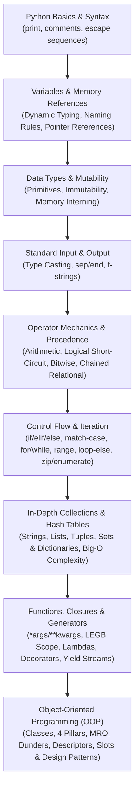
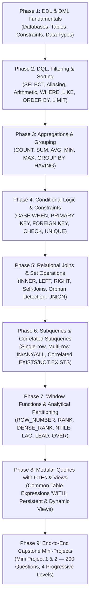

# 🚀 Data Engineering Bootcamp — SQL & Python

[](https://www.mysql.com/)
[](https://www.python.org/)
[-F80000?style=for-the-badge&logo=sqlite&logoColor=white)](https://en.wikipedia.org/wiki/SQL)
[](#)
[](#)
[](https://github.com/wasim-akthar)

A structured, hands-on repository documenting my journey through the **Data Engineering Bootcamp**, featuring intensive practical coursework in **Relational Database Management Systems (RDBMS)**, advanced SQL query optimization, database schema modeling, and core **Python programming foundations** tailored for data pipelines and analytics.

---

## 📌 Repository Overview

This repository serves as a centralized portfolio of daily coursework, class notes, speed drills, timed assessments, and capstone mini-projects completed during the bootcamp. The codebase showcases progressive mastery across:
1. **Relational Database Engineering (MySQL)**: From relational mechanics to advanced modern SQL paradigms including Window Functions, CTEs, Database Views, Correlated Subqueries, and complex schema design.
2. **Core Python for Data Engineering**: Foundational programming, memory management, dynamic typing, built-in data types, input/output operations, and comprehensive operator mechanics with an emphasis on interview preparation and data pipeline readiness.

### 🌟 Key Highlights

- **500+ Practice & Assessment Problems**: Solved query exercises ranging from foundational filtering to advanced analytical queries and interview-level problem sets.
- **Two 100-Question Capstone Mini-Projects**:
  - **Mini Project 1**: End-to-end relational schema, constraints, multi-table joins, reporting, and data lifecycle management for a College Student Marks System.
  - **Mini Project 2 (Subqueries Edition)**: 100 progressive questions partitioned across 4 distinct difficulty tiers (Beginner, Intermediate, Hard, Interview Level).
- **Production-Style SQL Case Studies**: Real-world schema designs and query solutions for **Google Pay (GPay)** (payments, balance auditing, transaction logs), **Swiggy** (food delivery), **BookMyShow** (cinema ticketing), **Rapido** (ride-hailing), **Amazon Sales** (e-commerce revenue), and **Myntra** (product catalogs).
- **Modern Analytical SQL**: In-depth implementations of Window Functions (`ROW_NUMBER`, `RANK`, `DENSE_RANK`, `NTILE`, `LAG`, `LEAD`), `PARTITION BY`, Common Table Expressions (`WITH`), and Database Views.
- **Python Foundations & Interview Notes**: Detailed class notes covering variables, memory pointer references, mutability vs. immutability, type casting, operator precedence, short-circuit evaluation, and time-complexity trade-offs (e.g., $O(1)$ set lookups vs. $O(n)$ list scans).
- **Production-Grade Object-Oriented Programming (OOP)**: Exhaustive three-part OOP curriculum covering classes, objects, constructor initialization, class vs. instance attributes, magic dunder methods, property descriptors (`@property`), the 4 pillars (Encapsulation, 5 types of Inheritance, Duck Typing & Overriding Polymorphism, ABC Abstraction contracts), C3 Linearization MRO, Composition architectures, Context Managers (`__enter__`/`__exit__`), memory optimization with `__slots__` (saving 40-60% RAM), and enterprise Design Patterns (Singleton, Factory, Template Method).

---

## 📂 Repository Structure

```plaintext
data-engineering-bootcamp/
├── .gitignore                       # Repository ignore rules (temporary files, caches)
├── README.md
├── Python Files/                    # Core Python programming & pipeline scripts
│   ├── Class Assignments/           # Daily graded assignments & coding questionnaires
│   │   ├── DOCX Files/              # Written assignment documentation & output reports
│   │   │   ├── Python Assignment - 30-10-26 - Wasim Akthar.docx
│   │   │   └── Python Assignment - 12-11-26 - Wasim Akthar.docx
│   │   ├── Python Assignment - 30-10-26 - Wasim Akthar.py # 50-Question Comprehensive Python Drill
│   │   └── Python Assignment - 12-11-26 - Wasim Akthar.py # 50-Question Scenario-Based Assignment
│   ├── Class Tests/                 # Timed programming assessments & quizzes
│   │   └── Class Test - 18-11-26 - Wasim Akthar.py # Practical assessment on Lists, Tuples, Sets & Dictionaries
│   ├── Notes/                       # Daily lecture notes, syntax primers & deep-dives
│   │   ├── Class Notes - 26-10-26 - Basics.py      # Python basics, syntax, print() & comments
│   │   ├── Class Notes - 27-10-26 - Variables.py   # Variables, Data Types, I/O & Interview Tips
│   │   ├── Class Notes - 28-10-26 - Operators.py   # Arithmetic, Comparison, Logical, Bitwise, etc.
│   │   ├── Class Notes - 30-10-26 - Control Statements.py # If, Else, Elif, Ternary, Match-Case
│   │   ├── Class Notes - 02-11-26 - Looping Statements.py # For, While, Range, Break, Continue, Else
│   │   ├── Class Notes - 04-11-26 - Strings.py     # String Immutability, Slicing, Methods, Patterns
│   │   ├── Class Notes - 10-11-26 - Lists.py       # Lists In-Depth, Mutability, Copies, Slicing, Big-O
│   │   ├── Class Notes - 12-11-26 - Tuples.py      # Tuples In-Depth, Immutability, Unpacking, Namedtuples
│   │   ├── Class Notes - 13-11-26 - Sets.py        # Sets & Frozensets, Hash Tables, Set Algebra, Big-O
│   │   ├── Class Notes - 16-11-26 - Dictionaries.py # Dicts In-Depth, JSON Payloads, Views, Big-O, defaultdict
│   │   ├── Class Notes - 17-11-26 - Functions.py   # Functions, *args/**kwargs, LEGB Scope, Closures, Decorators, Generators
│   │   ├── Class Notes - 20-11-26 - OOP Part 1 - Classes and Objects.py # Classes, self, Class/Instance Attrs, Dunders, Properties
│   │   ├── Class Notes - 20-11-26 - OOP Part 2 - Four Pillars.py # Encapsulation, Inheritance, MRO, Polymorphism, ABC Abstraction
│   │   └── Class Notes - 20-11-26 - OOP Part 3 - Advanced and Patterns.py # Composition, Operators, Context Managers, Slots, Design Patterns
│   ├── Rough Work/                  # Interactive hands-on practice & scratch drills
│   │   ├── Rough Work - Operators.py               # Hands-on practice with operators
│   │   ├── Rough Work - Conditional Statements.py  # Practice drills for if/elif/else & ternary
│   │   ├── Rough Work - Looping Statements.py      # Practice drills for loops, patterns & ranges
│   │   ├── Rough Work - Strings.py                 # String manipulation practice drills
│   │   ├── Rough Work - Lists.py                   # List operations & exercises
│   │   ├── Rough Work - Sets.py                    # Set operations & deduplication drills
│   │   ├── Rough Work - Dictionaries.py            # Dictionary key-value manipulations & grouping
│   │   ├── Rough Work - Functions.py               # Function definitions, scopes, *args/**kwargs drills
│   │   └── Rough Work - OOPS.py                    # Hands-on OOP drills: Single, Multiple, Multi-Level & Hierarchical Inheritance
│   ├── Practice Tests/              # Speed drills & self-assessment challenges
│   │   └── FAQs/                    # Classic interview coding challenges
│   │       └── Greatest Of 3.py     # Chained ternary & logical comparison for 3 numbers
│   └── Self Practice Assignments/   # Intensive coding challenges & algorithm drills
│
└── SQL Files/
    ├── Class Assignments/           # Daily graded assignments & real-world scenario sets
    │   ├── DOCX files/              # Written assignment documentation & output reports
    │   │   ├── SQL Assignment 23-09-26 Wasim Akthar.docx
    │   │   ├── SQL Assignment 20-10-26 - Wasim Akthar.docx
    │   │   └── ... (full submission docs)
    │   ├── SQL Assignment 23-09-26 - Wasim Akthar.sql  # Student Management System (DDL, DML, DQL)
    │   ├── SQL Assignment 24-09-26 - Wasim Akthar.sql  # Employee Details & Arithmetic Calculations
    │   ├── SQL Assignment 29-09-26 - Wasim Akthar.sql  # Employee (emp) Table & Self-Joins (30 Qs)
    │   ├── SQL Assignment 30-09-26 - Wasim Akthar.sql  # Advanced Filtering (WHERE/AND/OR/IN/BETWEEN)
    │   ├── SQL Assignment 01-10-26 - Wasim Akthar.sql  # Sorting, Ranking & Pagination (50 Qs)
    │   ├── SQL Assignment 06-10-26 - Wasim Akthar.sql  # Employee Aggregations & Grouping (30 Qs)
    │   ├── SQL Assignment 07-10-26 - Wasim Akthar.sql  # Orders Table & CASE Expressions (30 Qs)
    │   ├── SQL Assignment 08-10-26 - Wasim Akthar.sql  # Multi-Table JOINS (Emp, Dept, Projects)
    │   ├── SQL Assignment 09-10-26 - Wasim Akthar.sql  # E-Commerce Application & Constraints (30 Qs)
    │   ├── SQL Assignment 12-10-26 - Wasim Akthar.sql  # Mini-Project 1: Student Marks System (100 Qs)
    │   ├── SQL Assignment 15-10-26 - Wasim Akthar.sql  # Customers & Orders (Joins & Subqueries)
    │   ├── SQL Assignment 20-10-26 - Wasim Akthar.sql  # Student Details: Subqueries & Window Functions
    │   └── SQL Assignment 26-10-26 - Wasim Akthar.sql  # GPay Payment App (30 Qs: DDL, Joins, Windows, CTEs)
    │
    ├── Class Tests/                 # Timed assessments & evaluations under exam conditions
    │   ├── Class Test 15-10-26.sql  # Assessment on Joins, Aggregations & Subqueries
    │   ├── Class Test 20-10-26.sql  # Assessment on Subqueries & Window Functions
    │   └── Class Test 23-10-26.sql  # Comprehensive 30-Question SQL Test (Joins, CTEs, Views, Windows)
    │
    ├── Notes/                       # Daily lecture notes, syntax primers & schema walkthroughs
    │   ├── Basic Commands.sql       # Table creation & initial DDL/DML
    │   ├── Basic Commands - 2.sql   # Data insertion & query fundamentals
    │   ├── Basic Lessons.sql        # Data types & baseline constraints
    │   ├── Distinct and Alias.sql   # DISTINCT keyword and column aliasing
    │   ├── Basic SELECT and Arithmetic Exercises.sql # Calculations & bonuses
    │   ├── Employees DB.sql         # Base Employee schema & verification
    │   ├── BookMyShowDB.sql         # Movie ticketing database modeling
    │   ├── Filter and Aggregations.sql # Swiggy DB order aggregations
    │   ├── Class Notes 30-09-26.sql # Compound filtering operators
    │   ├── Class Notes 05-10-26.sql # ORDER BY, LIMIT, OFFSET, Top-N
    │   ├── Class Notes 07-10-26.sql # Swiggy DB grouped aggregations
    │   ├── Class Notes 08-10-26.sql # HAVING clause & CASE expressions
    │   ├── Class Notes 09-10-26.sql # Integrity Constraints (PK, FK, UNIQUE, CHECK, DEFAULT)
    │   ├── Class Notes 12-10-26.sql # Relational Joins & Unmatched records
    │   ├── Class Notes 13-10-26.sql # Subquery mechanics & Foreign Key structures
    │   ├── Class Notes 14-10-26.sql # Myntra DB: Single & multi-row subqueries
    │   ├── Class Notes 16-10-26 - Window Functions.sql # Amazon Sales: Window Functions & Partitions
    │   ├── Class Notes 21-10-26 - CTE, Views.sql       # Rapido DB: CTEs (`WITH`) vs. Database Views
    │   └── Class Notes 22-10-26 - DATE TIME.sql        # Temporal & Date/Time operations
    │
    ├── Practice Tests/              # Speed drills & self-assessment challenges
    │   ├── Practice Assignment Wasim Akthar - 06-10.26.sql # 30-Question Employee Table Speed Drill
    │   ├── Practice Test Wasim Akthar - 06-10-26.sql       # Assessment Test on emp Table
    │   └── Practice Test Wasim Akthar - 14-10-26.sql       # Students DB Correlated Subquery Challenge
    │
    └── Self Practice Assignments/   # Intensive marathon problem sets
        ├── Practice Assignment Wasim Akthar - Pt 1.sql     # 100-Question Comprehensive SQL Drill
        └── Practice Assignment Wasim Akthar - Pt 2.sql     # Mini-Project 2: 100 Qs across 4 Levels (with Subqueries)
```

---

## 🐍 Python Curriculum & Engineering Progression



### Python Module Breakdown

| Module / Topic | Core Concepts Covered | Key Implementation Files |
| :--- | :--- | :--- |
| **1. Basics & Output** | `print()` syntax, string literals, newline `\n` escapes, basic expressions. | `Class Notes - 26-10-26 - Basics.py` |
| **2. Variables & Dynamic Typing** | Variable assignment (`var = val`), reference pointers, dynamic typing at runtime, PEP 8 naming conventions, multiple assignment, and in-place variable swapping (`a, b = b, a`). | `Class Notes - 27-10-26 - Variables.py` |
| **3. Data Types & Mutability** | Built-in primitives (`int`, `float`, `str`, `bool`, `NoneType`) vs collections (`list`, `tuple`, `set`, `dict`); mutable vs immutable types; hashing & dictionary key constraints; falsy values. | `Class Notes - 27-10-26 - Variables.py` |
| **4. Input & Formatting** | `input()` string default behavior, type conversion (`int()`, `float()`), `sep` and `end` parameters in `print()`, string concatenation with `str()`, and modern formatted strings (f-strings). | `Class Notes - 27-10-26 - Variables.py` |
| **5. Python Operators** | Comprehensive coverage of **Arithmetic** (`/` vs `//`, `%`), **Comparison** (chaining `10 < n < 20`), **Logical** (short-circuiting `and`, `or`, `not`), **Assignment** (`+=`, `-=`, etc.), **Membership** (`in`, `not in`), **Identity** (`is`, `is not`), **Bitwise** (`&`, `\|`, `^`, `~`, `<<`, `>>`), and **Precedence**. | `Class Notes - 28-10-26 - Operators.py`, `Rough Work - Operators.py` |
| **6. Control Statements & Branching** | Python indentation rules (PEP 8), `if`, `if-else`, `if-elif-else` ladder, nested conditionals, ternary expressions & chained ternaries (`Greatest of 3`), structural pattern matching (`match-case`), and `pass` statements. | `Class Notes - 30-10-26 - Control Statements.py`, `Rough Work - Conditional Statements.py`, `Practice Tests/FAQs/Greatest Of 3.py` |
| **7. Looping & Iteration Mechanics** | `for` loops across collections/mappings, lazy `range()` generator mechanics (start, stop, step), `while` loops, loop flow control (`break`, `continue`, `pass`), Python-unique `loop-else` ("nobreak") clause, nested loops, and loop helpers (`enumerate()`, `zip()`). | `Class Notes - 02-11-26 - Looping Statements.py`, `Rough Work - Looping Statements.py` |
| **8. String Manipulation & Text Cleansing** | String immutability and memory caching (interning), indexing & step slicing (`s[::-1]`), concatenation performance anti-patterns (`+=` vs `"".join()`), stripping/cleaning (`strip`, `removeprefix`), search/counting (`find` vs `index`), string validation (`is...`), formatted strings (f-strings), and interview patterns (Palindromes, Anagrams, Vowels, Deduplication). | `Class Notes - 04-11-26 - Strings.py`, `Rough Work - Strings.py` |
| **9. Python Lists & Sequence Operations** | Ordered, mutable, dynamic over-allocation, indexing, slicing, in-place modification, adding (`append` vs `extend` vs `insert`), removing (`remove` vs `pop` vs `del` vs `clear`), searching (`count`, `index`), sorting (`sort()` vs `sorted()`), shallow vs deep copy (`copy.deepcopy()`), list comprehensions, Big-O time complexity table, and interview patterns (second largest, deduplication, list rotation, move zeros, merge sorted lists). | `Class Notes - 10-11-26 - Lists.py`, `Rough Work - Lists.py` |
| **10. Python Tuples & Data Integrity** | Ordered, immutable, heterogeneous, single-element tuple trap `(5,)`, indexing & slicing, tuple packing & unpacking, extended unpacking with `*`, the mutable-object-inside-tuple nuance, DB-API cursor row immutability, `namedtuple` schemas, and memory footprint benchmarks vs lists. | `Class Notes - 12-11-26 - Tuples.py` |
| **11. Python Sets & Hash-Based Algebra** | Unordered, unique, mutable collections, empty set trap `set()` vs `{}`, duplicate purging, `add` vs `update`, `remove` vs `discard` error handling, mathematical set theory (Union `\|`, Intersection `&`, Difference `-`, Symmetric Difference `^`), in-place mutations, subset/superset checks, immutable `frozenset` as dictionary keys, set comprehensions, $O(1)$ hash table lookup mechanics, and data reconciliation discrepancy detection. | `Class Notes - 13-11-26 - Sets.py`, `Rough Work - Sets.py` |
| **12. Python Dictionaries & Hash Mapping** | Ordered key-value pairs (Python 3.7+), hashable immutable key constraints, bracket access vs safe `.get()`, addition/overwrites, Python 3.9+ merge operators (`\|` and `\|=`), `pop` vs `popitem` vs `del` vs `clear`, dynamic view objects (`keys()`, `values()`, `items()`) and key set algebra, shallow vs deep copying, dictionary comprehensions (filtering, value swapping, pairing with `zip`), `defaultdict` and `Counter`, dense hash table $O(1)$ lookup mechanics, and interview patterns (word frequency, multi-dict summation, group anagrams, nested JSON flattening). | `Class Notes - 16-11-26 - Dictionaries.py`, `Rough Work - Dictionaries.py` |
| **13. Functions & Modular Engineering** | Function definitions, implicit `None` returns, multi-value returns via tuple packing/unpacking, parameter vs argument taxonomy, default mutable argument trap (`def f(x=[])` bug & fix), positional `*args` and arbitrary keyword `**kwargs` unpacking with nested dictionaries (e.g., Swiggy order processing), positional-only (`/`) & keyword-only (`*`) enforcement, variable scoping & the **LEGB rule** (`global` and `nonlocal`), pass-by-object-reference mechanics, anonymous lambda expressions, higher-order functional tools (`map`, `filter`, `reduce`), recursion limits, execution timing decorators & closures, memory-efficient streaming generators (`yield`), and interview patterns (prime check, nested list flattening, memoized Fibonacci). | `Class Notes - 17-11-26 - Functions.py`, `Rough Work - Functions.py` |
| **14. OOP Part 1: Classes, Attributes & Methods** | Class blueprints vs concrete instances (cookie-cutter analogy), constructor `__init__`, explicit `self` binding, Class Attributes vs. Instance Attributes and shadowing pitfalls, Instance vs. `@classmethod` (alternative constructors via `cls`) vs. `@staticmethod` (utility helpers), core magic dunder methods (`__str__`, `__repr__`, `__len__`, `__eq__`), property decorators (`@property`, `@setter`, `@deleter`), and an end-to-end production ETL pipeline class. | `Class Notes - 20-11-26 - OOP Part 1 - Classes and Objects.py` |
| **15. OOP Part 2: The 4 Pillars of OOP** | Exhaustive reference guide for the 4 pillars: **Encapsulation** (Public, Protected `_`, Private `__`, Getters/Setters, Name Mangling verification `_Class__attr`), **Inheritance** (Detailed breakdown and implementation of all 5 types: Single, Multi-Level, Hierarchical, Multiple, and Hybrid; `super()` mechanics; Method Resolution Order via C3 Linearization algorithm), **Polymorphism** (Method Overriding, Duck Typing across Spark/Pandas/SQL engines, and Operator Overloading via dunder methods), and **Abstraction** (`abc` module, `ABC`, `@abstractmethod` contract enforcement, Template Method design pattern, and direct instantiation guards). | `Class Notes - 20-11-26 - OOP Part 2 - Four Pillars.py`, `Rough Work - OOPS.py` |
| **16. OOP Part 3: Advanced OOP & Design Patterns** | Composition over Inheritance ("HAS-A" vs "IS-A") in modular pipeline architectures, custom Operator Overloading (`__add__`, `__gt__` for `Money` objects), Custom Context Managers (`__enter__`, `__exit__`) guaranteeing safe DB connection lifecycles without resource leaks, extreme memory optimization with `__slots__` (disabling `__dict__` to save 40-60% RAM in high-throughput data processing), and production design patterns (**Singleton** connection pools via `__new__`, **Factory** multi-database dynamic client instantiation). | `Class Notes - 20-11-26 - OOP Part 3 - Advanced and Patterns.py` |
| **17. Timed Python Collections Evaluation** | Comprehensive hands-on test evaluating operations across all 4 built-in Python collections (**Lists**, **Tuples**, **Sets**, and **Dictionaries**): item manipulation, immutability constraints, set algebra (union, intersection, difference), and key-value lookups. | `Class Test - 18-11-26 - Wasim Akthar.py` |
| **18. Python Practice Questionnaire** | Comprehensive 50-question hands-on drill spanning Variables, Data Types, Type Conversions, String/Integer I/O, Operators, and Control Statements with accompanying Microsoft Word output submission report. | `Python Assignment - 30-10-26 - Wasim Akthar.py`, `Python Assignment - 30-10-26 - Wasim Akthar.docx` |
| **19. Python Scenario-Based Assignment** | 50 scenario-driven questions simulating real-world engineering data: Employee master data, company metrics, salary calculations, customer profiles, e-commerce orders, temperature thresholds, student grading, and list/string processing with structured Word report documentation. | `Python Assignment - 12-11-26 - Wasim Akthar.py`, `Python Assignment - 12-11-26 - Wasim Akthar.docx` |

---

## 🗺️ SQL Curriculum & Learning Progression



### SQL Module Breakdown

| Module / Topic | Core Concepts Covered | Key Implementation Files |
| :--- | :--- | :--- |
| **1. Database & Table Foundations** | `CREATE DATABASE`, `USE`, `CREATE TABLE`, `DESC`, `INSERT INTO`, data types (`INT`, `VARCHAR`, `DECIMAL`, `DATE`). | `Employees DB.sql`, `Basic Commands.sql` |
| **2. DQL, Aliases & Arithmetic** | `SELECT`, column aliases (`AS`), arithmetic computations (`+`, `-`, `*`, `/`), `ROUND()`, bonus & tax logic. | `Basic SELECT and Arithmetic Exercises.sql`, `SQL Assignment 24-09-26` |
| **3. Filtering, Matching & Pagination** | `WHERE`, logical operators (`AND`, `OR`, `NOT`), `IN`, `BETWEEN`, `LIKE`, `IS NULL`, `ORDER BY`, `LIMIT`, `OFFSET`, Top-N / Nth highest records. | `SQL Assignment 30-09-26`, `SQL Assignment 01-10-26` (50 Qs) |
| **4. Aggregations & Grouping** | `COUNT()`, `SUM()`, `AVG()`, `MIN()`, `MAX()`, `GROUP BY`, `HAVING` clause vs. `WHERE` clause. | `Filter and Aggregations.sql`, `SQL Assignment 06-10-26` |
| **5. Conditional Logic & Data Integrity** | `CASE WHEN ... THEN ... ELSE END`, conditional bucketing, integrity constraints (`PRIMARY KEY`, `FOREIGN KEY`, `NOT NULL`, `UNIQUE`, `CHECK`, `DEFAULT`). | `Class Notes 08-10-26.sql`, `SQL Assignment 07-10-26`, `SQL Assignment 09-10-26` |
| **6. Relational Joins & Set Operations** | `INNER JOIN`, `LEFT JOIN`, `RIGHT JOIN`, self-joins (hierarchical employee-manager models), detecting orphaned records (`IS NULL`), `UNION` & `UNION ALL`. | `Class Notes 12-10-26.sql`, `SQL Assignment 08-10-26` |
| **7. Subqueries & Correlated Queries** | Single-row scalar subqueries, multi-row subqueries (`IN`, `ANY`, `ALL`), correlated subqueries (`EXISTS`, `NOT EXISTS`). | `Class Notes 13-10-26.sql`, `Class Notes 14-10-26.sql`, `Practice Test 14-10-26.sql` |
| **8. Window Functions & Ranking** | `ROW_NUMBER()`, `RANK()`, `DENSE_RANK()`, `NTILE()`, `LAG()`, `LEAD()`, `FIRST_VALUE()`, `LAST_VALUE()`, `NTH_VALUE()`, `OVER (PARTITION BY ... ORDER BY ...)`. | `Class Notes 16-10-26 - Window Functions.sql`, `SQL Assignment 20-10-26` |
| **9. CTEs & Virtual Views** | Common Table Expressions (`WITH cte AS (...)`), modular multi-step querying, `CREATE OR REPLACE VIEW`, view query optimization. | `Class Notes 21-10-26 - CTE, Views.sql`, `Class Test 23-10-26.sql` |
| **10. Capstone Mini-Projects & Tests** | 200 questions across two end-to-end Mini-Projects, plus comprehensive timed tests covering all advanced topics. | `SQL Assignment 12-10-26`, `Practice Assignment Pt 2.sql`, `Class Test 23-10-26` |

---

## 🏆 Featured Projects & Real-World Case Studies

### 🎓 1. College Student Marks Management System (Mini-Project 1 & 2)
- **Files**:
  - Mini-Project 1: `SQL Files/Class Assignments/SQL Assignment 12-10-26 - Wasim Akthar.sql` (100 Questions)
  - Mini-Project 2: `SQL Files/Self Practice Assignments/Practice Assignment Wasim Akthar - Pt 2.sql` (100 Questions across 4 Levels)
- **Scope**: **200 Curated Problems**
- **Schema**:
  - `students`: `student_id`, `student_name`, `department`, `city`, `age`, `email`
  - `marks`: `mark_id`, `student_id` (FK), `python_marks`, `sql_marks`, `aptitude_marks`
- **Difficulty Tiers (Mini-Project 2)**:
  - **Level 1 (Beginner — Q1 to Q25)**: DDL constraints, arithmetic expressions, aggregate totals, and basic filters.
  - **Level 2 (Intermediate — Q26 to Q50)**: `GROUP BY`, `HAVING`, `CASE` conditional aggregations, and multi-table joins.
  - **Level 3 (Hard — Q51 to Q75)**: Single-row & multi-row subqueries, top performers per department, and reversible DML manipulations.
  - **Level 4 (Interview Level — Q76 to Q100)**: Correlated subqueries (`EXISTS`/`NOT EXISTS`), percentile benchmarks, schema refactoring (`ALTER`/`RENAME`), and cascaded deletes.

### 🚖 2. Rapido Ride-Hailing Analytics (CTEs vs. Views)
- **File**: `SQL Files/Notes/Class Notes 21-10-26 - CTE, Views.sql`
- **Focus**:
  - Multi-city driver fleet performance analysis (`drivers` table across Mumbai, Delhi, Bengaluru, Chennai, etc.).
  - Demonstrating temporary query modularization using **CTEs** (`WITH chennai_drivers AS (...)`) versus persistent abstraction layers using **Views** (`CREATE VIEW`).
  - Benchmarking readability, maintainability, and reusability across data processing pipelines.

### 📦 3. Amazon Sales & Revenue Analytics (Window Functions)
- **File**: `SQL Files/Notes/Class Notes 16-10-26 - Window Functions.sql`
- **Focus**:
  - Product sales transactions across electronics and books categories.
  - Category-level sales partitioning (`PARTITION BY category`).
  - Comparative ranking behavior analysis (`ROW_NUMBER()` vs. `RANK()` vs. `DENSE_RANK()`).
  - Positional value retrieval using `FIRST_VALUE()`, `LAST_VALUE()`, and `NTILE(n)`.

### 🍕 4. Swiggy Food Delivery & Order Analytics
- **Files**: `SQL Files/Notes/Filter and Aggregations.sql`, `SQL Files/Notes/Class Notes 07-10-26.sql`
- **Focus**:
  - Aggregating order volumes by customer, city, and restaurant.
  - Spend distribution across customer segments.
  - Identifying top-grossing restaurants using grouped filtering (`HAVING`).

### 🎬 5. BookMyShow Cinema Ticketing System
- **File**: `SQL Files/Notes/BookMyShowDB.sql`
- **Focus**:
  - Relational schema modeling for multiplex ticket booking.
  - Entity relationships using auto-increment primary keys, foreign constraints, and showtime metadata.

### 🛍️ 6. E-Commerce Order Management (Online Shopping & Myntra)
- **Files**: `SQL Files/Class Assignments/SQL Assignment 09-10-26 - Wasim Akthar.sql`, `SQL Files/Notes/Class Notes 14-10-26.sql`
- **Focus**:
  - Strict schema integrity (`CHECK price > 0`, `UNIQUE email`, `NOT NULL`).
  - Correlated subqueries to find customers who placed above-average orders or purchased in specific product categories.

### 💳 7. Google Pay (GPay) Payment Application & Transaction Audits
- **File**: `SQL Files/Class Assignments/SQL Assignment 26-10-26 - Wasim Akthar.sql`
- **Scope**: **30 Comprehensive Scenario Queries**
- **Schema**:
  - `Customers`: `customer_id`, `customer_name`, `city`, `age`
  - `Bank_Accounts`: `account_id`, `customer_id` (FK), `bank_name`, `account_type`, `balance`
  - `Transactions`: `txn_id`, `from_account_id` (FK), `to_account_id` (FK), `amount`, `txn_date`, `status`
- **Focus**:
  - Multi-table financial modeling across customer accounts, bank tiers, and money transfer ledgers.
  - Schema alterations (`ALTER TABLE`), transactional updates, and integrity constraint enforcement.
  - Aggregations and grouping by bank providers and transaction lifecycle status (`SUCCESS`, `FAILED`, `PENDING`).
  - Correlated subqueries (`EXISTS` / `NOT EXISTS`) isolating active accounts and transfer volumes.
  - Window ranking (`ROW_NUMBER`, `DENSE_RANK`, `NTILE`) and CTEs (`WITH`) to audit top-volume transfers and balance distributions.

---

## 📝 Timed Class Tests & Evaluations

| Test Script | Date | Topics Evaluated | Format |
| :--- | :--- | :--- | :--- |
| `Class Test 15-10-26.sql` | 15-Oct-2026 | Multi-table JOINS (`INNER`, `LEFT`, `RIGHT`), orphaned record detection (`IS NULL`), aggregate spending, and correlated subqueries (`EXISTS`, `NOT EXISTS`, `AVG`, `MAX`, `ANY`). | Timed Hands-on |
| `Class Test 20-10-26.sql` | 20-Oct-2026 | Subquery scenarios (above-average fee extraction, 2nd & 3rd highest distinct fees without `LIMIT`) and Window Functions (`ROW_NUMBER`, `RANK`, `DENSE_RANK`, `LAG`, `LEAD`, `NTILE`). | Timed Hands-on |
| `Class Test 23-10-26.sql` | 23-Oct-2026 | Comprehensive 30-Question Assessment: Part 1 Beginner (Q1–Q10) covering Aggregates, `GROUP BY`, `HAVING`; Part 2 Intermediate (Q11–Q30) covering Joins, Subqueries, Views, Window Functions, and CTEs. | 30-Question Structured Exam |

---

## 🛠️ Getting Started & Execution

### Prerequisites
- **Python**: [Python 3.10+](https://www.python.org/)
- **Database**: [MySQL Server](https://dev.mysql.com/downloads/mysql/) (v8.0 or newer recommended for CTEs and Window Functions)
- **Tools / IDEs**: VS Code, [MySQL Workbench](https://www.mysql.com/products/workbench/) or [DBeaver](https://dbeaver.io/).

### Running Python Scripts

```bash
# Execute class notes and drills
python "Python Files/Notes/Class Notes - 27-10-26 - Variables.py"
python "Python Files/Notes/Class Notes - 28-10-26 - Operators.py"
python "Python Files/Notes/Class Notes - 30-10-26 - Control Statements.py"
python "Python Files/Notes/Class Notes - 02-11-26 - Looping Statements.py"
python "Python Files/Notes/Class Notes - 04-11-26 - Strings.py"
python "Python Files/Notes/Class Notes - 10-11-26 - Lists.py"
python "Python Files/Notes/Class Notes - 12-11-26 - Tuples.py"
python "Python Files/Notes/Class Notes - 13-11-26 - Sets.py"
python "Python Files/Notes/Class Notes - 16-11-26 - Dictionaries.py"
python "Python Files/Notes/Class Notes - 17-11-26 - Functions.py"
python "Python Files/Notes/Class Notes - 20-11-26 - OOP Part 1 - Classes and Objects.py"
python "Python Files/Notes/Class Notes - 20-11-26 - OOP Part 2 - Four Pillars.py"
python "Python Files/Notes/Class Notes - 20-11-26 - OOP Part 3 - Advanced and Patterns.py"
python "Python Files/Rough Work/Rough Work - Functions.py"
python "Python Files/Rough Work/Rough Work - OOPS.py"
python "Python Files/Class Tests/Class Test - 18-11-26 - Wasim Akthar.py"
python "Python Files/Class Assignments/Python Assignment - 30-10-26 - Wasim Akthar.py"
python "Python Files/Class Assignments/Python Assignment - 12-11-26 - Wasim Akthar.py"
python "Python Files/Practice Tests/FAQs/Greatest Of 3.py"
```

### Running SQL Scripts

1. **Via MySQL CLI**:
   ```bash
   mysql -u <username> -p < "SQL Files/Class Assignments/SQL Assignment 12-10-26 - Wasim Akthar.sql"
   ```

2. **Via MySQL Workbench / DBeaver**:
   - Open any `.sql` file in the IDE.
   - Execute the setup statements (`CREATE DATABASE`, `USE`, `CREATE TABLE`, `INSERT`).
   - Run the analytical query sections to verify outputs.

---

## 📈 Roadmap & Progress Tracker

This repository is continuously maintained as the bootcamp progresses:

- [x] **Module 1**: Relational Databases & Advanced SQL Mastery (MySQL)
  - [x] DDL, DML, DQL Foundations & Constraints
  - [x] Multi-Table Relational Joins & Set Operations
  - [x] Scalar, Multi-Row & Correlated Subqueries
  - [x] Window Functions & Analytical Ranking
  - [x] Common Table Expressions (CTEs) & Database Views
  - [x] Capstone Mini-Projects & Timed Evaluations
- [x] **Module 2**: Python for Data Engineering (In Progress)
  - [x] Python Basics, Syntax, and Dynamic Typing
  - [x] Built-in Primitive & Collection Data Types (Mutability vs. Immutability)
  - [x] Standard Input, Output, and String Formatting (f-strings)
  - [x] Comprehensive Operator Mechanics (Arithmetic, Comparison, Logical, Assignment, Membership, Identity, Bitwise)
  - [x] Control Flow & Conditional Branching (if, elif, else, ternary, match-case)
  - [x] Iterations & Looping Statements (for, while, range, break, continue, loop-else, enumerate, zip)
  - [x] In-Depth String Manipulation & Data Cleansing (immutability, slicing, methods, f-strings, regex prep)
  - [x] Python Lists & In-Memory Transformations (mutability, memory over-allocation, shallow vs deep copy, Big-O, comprehensions)
  - [x] Python Tuples & Data Integrity (immutability, packing/unpacking, namedtuples, DB row fetches)
  - [x] Python Sets & Hash-Based Algebra (unique constraints, set algebra, frozenset, O(1) lookups, reconciliation)
  - [x] Python Dictionaries & Hash Mapping (key-value modeling, JSON payloads, view set algebra, defaultdict, Counter, nested flattening)
  - [x] Functions, Generators & Modular Engineering (LEGB scoping, *args/**kwargs, closures, decorators, yield streams)
  - [x] Object-Oriented Programming (OOP) — Classes, 4 Pillars (Encapsulation, 5 Inheritance Types, Polymorphism & Duck Typing, Abstraction), MRO C3 Linearization, Dunders, Descriptors, Context Managers, __slots__ & Design Patterns (Singleton, Factory, Template Method)
  - [ ] Error & Exception Handling (try-except-finally, custom exceptions)
  - [ ] Data Wrangling with Pandas & Polars
- [ ] **Module 3**: Data Modeling & Dimensional Warehousing (Star/Snowflake Schema, SCDs)
- [ ] **Module 4**: ETL / ELT Pipeline Development
- [ ] **Module 5**: Distributed Computing with Apache Spark & PySpark
- [ ] **Module 6**: Cloud Data Warehousing (Snowflake / Google BigQuery)
- [ ] **Module 7**: Workflow Orchestration (Apache Airflow / Dagster)

---

## 👤 Author

**Wasim Akthar**
- GitHub: [@wasim-akthar](https://github.com/wasim-akthar)
- Repository: [data-engineering-bootcamp](https://github.com/wasim-akthar/data-engineering-bootcamp)

---
*Contributions, suggestions, and feedback are welcome! ⭐ Star this repo if you find the SQL and Python materials helpful.*
