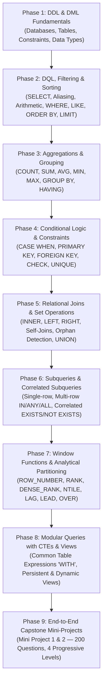

# 🚀 Data Engineering Bootcamp — SQL & Database Systems

[](https://www.mysql.com/)
[-F80000?style=for-the-badge&logo=sqlite&logoColor=white)](https://en.wikipedia.org/wiki/SQL)
[](#)
[](#)
[](https://github.com/wasim-akthar)

A structured, hands-on repository documenting my journey through the **Data Engineering Bootcamp**, featuring intensive practical coursework in **Relational Database Management Systems (RDBMS)**, advanced SQL query optimization, database schema modeling, and analytical problem-solving using **MySQL**.

---

## 📌 Repository Overview

This repository serves as a centralized portfolio of daily coursework, class notes, speed drills, timed assessments, and capstone mini-projects completed during the bootcamp. The codebase showcases progressive mastery from core relational mechanics to advanced modern SQL paradigms including **Window Functions**, **Common Table Expressions (CTEs)**, **Database Views**, **Correlated Subqueries**, and complex relational schema design.

### 🌟 Key Highlights

- **500+ Practice & Assessment Problems**: Solved query exercises ranging from foundational filtering to advanced analytical queries and interview-level problem sets.
- **Two 100-Question Capstone Mini-Projects**:
  - **Mini Project 1**: End-to-end relational schema, constraints, multi-table joins, reporting, and data lifecycle management for a College Student Marks System.
  - **Mini Project 2 (Subqueries Edition)**: 100 progressive questions partitioned across 4 distinct difficulty tiers (Beginner, Intermediate, Hard, Interview Level).
- **Production-Style Case Studies**: Real-world schema designs and query solutions for **Swiggy** (food delivery), **BookMyShow** (cinema ticketing), **Rapido** (ride-hailing), **Amazon Sales** (e-commerce revenue), and **Myntra** (product catalogs).
- **Modern Analytical SQL**: In-depth implementations of Window Functions (`ROW_NUMBER`, `RANK`, `DENSE_RANK`, `NTILE`, `LAG`, `LEAD`), `PARTITION BY`, Common Table Expressions (`WITH`), and Database Views.
- **Dual Documentation**: Production SQL scripts paired with structured Microsoft Word (`.docx`) submission deliverables.

---

## 📂 Repository Structure

```plaintext
data-engineering-bootcamp/
├── README.md
└── SQL Files/
    ├── Class Assignments/           # Daily graded assignments & real-world scenario sets
    │   ├── DOCX files/              # Written assignment documentation & output reports
    │   │   ├── SQL Assignment 23-09-26 Wasim Akthar.docx
    │   │   ├── SQL Assignment 20-10-26 - Wasim Akthar.docx
    │   │   └── ... (full submission docs)
    │   ├── SQL Assignment 23-09-26 - Wasim Akthar.sql  # Student Management System (DDL, DML, DQL)
    │   ├── SQL Assignment 24-09-26 - Wasim Akthar.sql  # Employee Details & Arithmetic Calculations
    │   ├── SQL Assignment 29-09-26 - Wasim Akthar.sql  # Employee (emp) Table & Self-Joins (30 Qs)
    │   ├── SQL Assignment 30-09-26 - Wasim Akthar.sql  # Advanced Filtering (WHERE/AND/OR/IN/BETWEEN)
    │   ├── SQL Assignment 01-10-26 - Wasim Akthar.sql  # Sorting, Ranking & Pagination (50 Qs)
    │   ├── SQL Assignment 06-10-26 - Wasim Akthar.sql  # Employee Aggregations & Grouping (30 Qs)
    │   ├── SQL Assignment 07-10-26 - Wasim Akthar.sql  # Orders Table & CASE Expressions (30 Qs)
    │   ├── SQL Assignment 08-10-26 - Wasim Akthar.sql  # Multi-Table JOINS (Emp, Dept, Projects)
    │   ├── SQL Assignment 09-10-26 - Wasim Akthar.sql  # E-Commerce Application & Constraints (30 Qs)
    │   ├── SQL Assignment 12-10-26 - Wasim Akthar.sql  # Mini-Project 1: Student Marks System (100 Qs)
    │   ├── SQL Assignment 15-10-26 - Wasim Akthar.sql  # Customers & Orders (Joins & Subqueries)
    │   └── SQL Assignment 20-10-26 - Wasim Akthar.sql  # Student Details: Subqueries & Window Functions
    │
    ├── Class Tests/                 # Timed assessments & evaluations under exam conditions
    │   ├── Class Test 15-10-26.sql  # Assessment on Joins, Aggregations & Subqueries
    │   ├── Class Test 20-10-26.sql  # Assessment on Subqueries & Window Functions
    │   └── Class Test 23-10-26.sql  # Comprehensive 30-Question SQL Test (Joins, CTEs, Views, Windows)
    │
    ├── Notes/                       # Daily lecture notes, syntax primers & schema walkthroughs
    │   ├── Basic Commands.sql       # Table creation & initial DDL/DML
    │   ├── Basic Commands - 2.sql   # Data insertion & query fundamentals
    │   ├── Basic Lessons.sql        # Data types & baseline constraints
    │   ├── Distinct and Alias.sql   # DISTINCT keyword and column aliasing
    │   ├── Basic SELECT and Arithmetic Exercises.sql # Calculations & bonuses
    │   ├── Employees DB.sql         # Base Employee schema & verification
    │   ├── BookMyShowDB.sql         # Movie ticketing database modeling
    │   ├── Filter and Aggregations.sql # Swiggy DB order aggregations
    │   ├── Class Notes 30-09-26.sql # Compound filtering operators
    │   ├── Class Notes 05-10-26.sql # ORDER BY, LIMIT, OFFSET, Top-N
    │   ├── Class Notes 07-10-26.sql # Swiggy DB grouped aggregations
    │   ├── Class Notes 08-10-26.sql # HAVING clause & CASE expressions
    │   ├── Class Notes 09-10-26.sql # Integrity Constraints (PK, FK, UNIQUE, CHECK, DEFAULT)
    │   ├── Class Notes 12-10-26.sql # Relational Joins & Unmatched records
    │   ├── Class Notes 13-10-26.sql # Subquery mechanics & Foreign Key structures
    │   ├── Class Notes 14-10-26.sql # Myntra DB: Single & multi-row subqueries
    │   ├── Class Notes 16-10-26 - Window Functions.sql # Amazon Sales: Window Functions & Partitions
    │   ├── Class Notes 21-10-26 - CTE, Views.sql       # Rapido DB: CTEs (`WITH`) vs. Database Views
    │   └── Class Notes 22-10-26 - DATE TIME.sql        # Temporal & Date/Time operations
    │
    ├── Practice Tests/              # Speed drills & self-assessment challenges
    │   ├── Practice Assignment Wasim Akthar - 06-10.26.sql # 30-Question Employee Table Speed Drill
    │   ├── Practice Test Wasim Akthar - 06-10-26.sql       # Assessment Test on emp Table
    │   └── Practice Test Wasim Akthar - 14-10-26.sql       # Students DB Correlated Subquery Challenge
    │
    └── Self Practice Assignments/   # Intensive marathon problem sets
        ├── Practice Assignment Wasim Akthar - Pt 1.sql     # 100-Question Comprehensive SQL Drill
        └── Practice Assignment Wasim Akthar - Pt 2.sql     # Mini-Project 2: 100 Qs across 4 Levels (with Subqueries)
```

---

## 🗺️ SQL Curriculum & Learning Progression



### Module Breakdown

| Module / Topic | Core Concepts Covered | Key Implementation Files |
| :--- | :--- | :--- |
| **1. Database & Table Foundations** | `CREATE DATABASE`, `USE`, `CREATE TABLE`, `DESC`, `INSERT INTO`, data types (`INT`, `VARCHAR`, `DECIMAL`, `DATE`). | `Employees DB.sql`, `Basic Commands.sql` |
| **2. DQL, Aliases & Arithmetic** | `SELECT`, column aliases (`AS`), arithmetic computations (`+`, `-`, `*`, `/`), `ROUND()`, bonus & tax logic. | `Basic SELECT and Arithmetic Exercises.sql`, `SQL Assignment 24-09-26` |
| **3. Filtering, Matching & Pagination** | `WHERE`, logical operators (`AND`, `OR`, `NOT`), `IN`, `BETWEEN`, `LIKE`, `IS NULL`, `ORDER BY`, `LIMIT`, `OFFSET`, Top-N / Nth highest records. | `SQL Assignment 30-09-26`, `SQL Assignment 01-10-26` (50 Qs) |
| **4. Aggregations & Grouping** | `COUNT()`, `SUM()`, `AVG()`, `MIN()`, `MAX()`, `GROUP BY`, `HAVING` clause vs. `WHERE` clause. | `Filter and Aggregations.sql`, `SQL Assignment 06-10-26` |
| **5. Conditional Logic & Data Integrity** | `CASE WHEN ... THEN ... ELSE END`, conditional bucketing, integrity constraints (`PRIMARY KEY`, `FOREIGN KEY`, `NOT NULL`, `UNIQUE`, `CHECK`, `DEFAULT`). | `Class Notes 08-10-26.sql`, `SQL Assignment 07-10-26`, `SQL Assignment 09-10-26` |
| **6. Relational Joins & Set Operations** | `INNER JOIN`, `LEFT JOIN`, `RIGHT JOIN`, self-joins (hierarchical employee-manager models), detecting orphaned records (`IS NULL`), `UNION` & `UNION ALL`. | `Class Notes 12-10-26.sql`, `SQL Assignment 08-10-26` |
| **7. Subqueries & Correlated Queries** | Single-row scalar subqueries, multi-row subqueries (`IN`, `ANY`, `ALL`), correlated subqueries (`EXISTS`, `NOT EXISTS`). | `Class Notes 13-10-26.sql`, `Class Notes 14-10-26.sql`, `Practice Test 14-10-26.sql` |
| **8. Window Functions & Ranking** | `ROW_NUMBER()`, `RANK()`, `DENSE_RANK()`, `NTILE()`, `LAG()`, `LEAD()`, `FIRST_VALUE()`, `LAST_VALUE()`, `NTH_VALUE()`, `OVER (PARTITION BY ... ORDER BY ...)`. | `Class Notes 16-10-26 - Window Functions.sql`, `SQL Assignment 20-10-26` |
| **9. CTEs & Virtual Views** | Common Table Expressions (`WITH cte AS (...)`), modular multi-step querying, `CREATE OR REPLACE VIEW`, view query optimization. | `Class Notes 21-10-26 - CTE, Views.sql`, `Class Test 23-10-26.sql` |
| **10. Capstone Mini-Projects & Tests** | 200 questions across two end-to-end Mini-Projects, plus comprehensive timed tests covering all advanced topics. | `SQL Assignment 12-10-26`, `Practice Assignment Pt 2.sql`, `Class Test 23-10-26` |

---

## 🏆 Featured Projects & Real-World Case Studies

### 🎓 1. College Student Marks Management System (Mini-Project 1 & 2)
- **Files**:
  - Mini-Project 1: `SQL Files/Class Assignments/SQL Assignment 12-10-26 - Wasim Akthar.sql` (100 Questions)
  - Mini-Project 2: `SQL Files/Self Practice Assignments/Practice Assignment Wasim Akthar - Pt 2.sql` (100 Questions across 4 Levels)
- **Scope**: **200 Curated Problems**
- **Schema**:
  - `students`: `student_id`, `student_name`, `department`, `city`, `age`, `email`
  - `marks`: `mark_id`, `student_id` (FK), `python_marks`, `sql_marks`, `aptitude_marks`
- **Difficulty Tiers (Mini-Project 2)**:
  - **Level 1 (Beginner — Q1 to Q25)**: DDL constraints, arithmetic expressions, aggregate totals, and basic filters.
  - **Level 2 (Intermediate — Q26 to Q50)**: `GROUP BY`, `HAVING`, `CASE` conditional aggregations, and multi-table joins.
  - **Level 3 (Hard — Q51 to Q75)**: Single-row & multi-row subqueries, top performers per department, and reversible DML manipulations.
  - **Level 4 (Interview Level — Q76 to Q100)**: Correlated subqueries (`EXISTS`/`NOT EXISTS`), percentile benchmarks, schema refactoring (`ALTER`/`RENAME`), and cascaded deletes.

### 🚖 2. Rapido Ride-Hailing Analytics (CTEs vs. Views)
- **File**: `SQL Files/Notes/Class Notes 21-10-26 - CTE, Views.sql`
- **Focus**:
  - Multi-city driver fleet performance analysis (`drivers` table across Mumbai, Delhi, Bengaluru, Chennai, etc.).
  - Demonstrating temporary query modularization using **CTEs** (`WITH chennai_drivers AS (...)`) versus persistent abstraction layers using **Views** (`CREATE VIEW`).
  - Benchmarking readability, maintainability, and reusability across data processing pipelines.

### 📦 3. Amazon Sales & Revenue Analytics (Window Functions)
- **File**: `SQL Files/Notes/Class Notes 16-10-26 - Window Functions.sql`
- **Focus**:
  - Product sales transactions across electronics and books categories.
  - Category-level sales partitioning (`PARTITION BY category`).
  - Comparative ranking behavior analysis (`ROW_NUMBER()` vs. `RANK()` vs. `DENSE_RANK()`).
  - Positional value retrieval using `FIRST_VALUE()`, `LAST_VALUE()`, and `NTILE(n)`.

### 🍕 4. Swiggy Food Delivery & Order Analytics
- **Files**: `SQL Files/Notes/Filter and Aggregations.sql`, `SQL Files/Notes/Class Notes 07-10-26.sql`
- **Focus**:
  - Aggregating order volumes by customer, city, and restaurant.
  - Spend distribution across customer segments.
  - Identifying top-grossing restaurants using grouped filtering (`HAVING`).

### 🎬 5. BookMyShow Cinema Ticketing System
- **File**: `SQL Files/Notes/BookMyShowDB.sql`
- **Focus**:
  - Relational schema modeling for multiplex ticket booking.
  - Entity relationships using auto-increment primary keys, foreign constraints, and showtime metadata.

### 🛍️ 6. E-Commerce Order Management (Online Shopping & Myntra)
- **Files**: `SQL Files/Class Assignments/SQL Assignment 09-10-26 - Wasim Akthar.sql`, `SQL Files/Notes/Class Notes 14-10-26.sql`
- **Focus**:
  - Strict schema integrity (`CHECK price > 0`, `UNIQUE email`, `NOT NULL`).
  - Correlated subqueries to find customers who placed above-average orders or purchased in specific product categories.

---

## 📝 Timed Class Tests & Evaluations

| Test Script | Date | Topics Evaluated | Format |
| :--- | :--- | :--- | :--- |
| `Class Test 15-10-26.sql` | 15-Oct-2026 | Multi-table JOINS (`INNER`, `LEFT`, `RIGHT`), orphaned record detection (`IS NULL`), aggregate spending, and correlated subqueries (`EXISTS`, `NOT EXISTS`, `AVG`, `MAX`, `ANY`). | Timed Hands-on |
| `Class Test 20-10-26.sql` | 20-Oct-2026 | Subquery scenarios (above-average fee extraction, 2nd & 3rd highest distinct fees without `LIMIT`) and Window Functions (`ROW_NUMBER`, `RANK`, `DENSE_RANK`, `LAG`, `LEAD`, `NTILE`). | Timed Hands-on |
| `Class Test 23-10-26.sql` | 23-Oct-2026 | Comprehensive 30-Question Assessment: Part 1 Beginner (Q1–Q10) covering Aggregates, `GROUP BY`, `HAVING`; Part 2 Intermediate (Q11–Q30) covering Joins, Subqueries, Views, Window Functions, and CTEs. | 30-Question Structured Exam |

---

## 🛠️ Getting Started & Execution

### Prerequisites
- [MySQL Server](https://dev.mysql.com/downloads/mysql/) (v8.0 or newer recommended for CTEs and Window Functions)
- A GUI client such as [MySQL Workbench](https://www.mysql.com/products/workbench/) or [DBeaver](https://dbeaver.io/), or the MySQL command-line client (`mysql`).

### Quick Setup

1. **Clone the repository**:
   ```bash
   git clone git@github.com:wasim-akthar/data-engineering-bootcamp.git
   cd data-engineering-bootcamp
   ```

2. **Run a script via MySQL CLI**:
   ```bash
   mysql -u <username> -p < "SQL Files/Class Assignments/SQL Assignment 12-10-26 - Wasim Akthar.sql"
   ```

3. **Or open in MySQL Workbench / DBeaver**:
   - Open any `.sql` file in the IDE.
   - Execute the setup statements (`CREATE DATABASE`, `USE`, `CREATE TABLE`, `INSERT`).
   - Run the analytical query sections to verify outputs.

> [!TIP]
> In files like `SQL Assignment 12-10-26 - Wasim Akthar.sql` and `Practice Assignment Wasim Akthar - Pt 2.sql`, questions are structured sequentially. Run the initial setup and table seeding sections first before testing subsequent analytical queries or DML mutations.

---

## 📈 Roadmap & Upcoming Modules

This repository is continuously maintained as the bootcamp progresses:

- [x] **Module 1**: Relational Databases & Advanced SQL Mastery (MySQL)
  - [x] DDL, DML, DQL Foundations & Constraints
  - [x] Multi-Table Relational Joins & Set Operations
  - [x] Scalar, Multi-Row & Correlated Subqueries
  - [x] Window Functions & Analytical Ranking
  - [x] Common Table Expressions (CTEs) & Database Views
  - [x] Capstone Mini-Projects & Timed Evaluations
- [ ] **Module 2**: Python for Data Engineering (Data Structures, OOP, Pandas, Polars)
- [ ] **Module 3**: Data Modeling & Dimensional Warehousing (Star/Snowflake Schema, SCDs)
- [ ] **Module 4**: ETL / ELT Pipeline Development
- [ ] **Module 5**: Distributed Computing with Apache Spark & PySpark
- [ ] **Module 6**: Cloud Data Warehousing (Snowflake / Google BigQuery)
- [ ] **Module 7**: Workflow Orchestration (Apache Airflow / Dagster)

---

## 👤 Author

**Wasim Akthar**
- GitHub: [@wasim-akthar](https://github.com/wasim-akthar)
- Repository: [data-engineering-bootcamp](https://github.com/wasim-akthar/data-engineering-bootcamp)

---
*Contributions, suggestions, and feedback are welcome! ⭐ Star this repo if you find the SQL problem sets helpful.*
